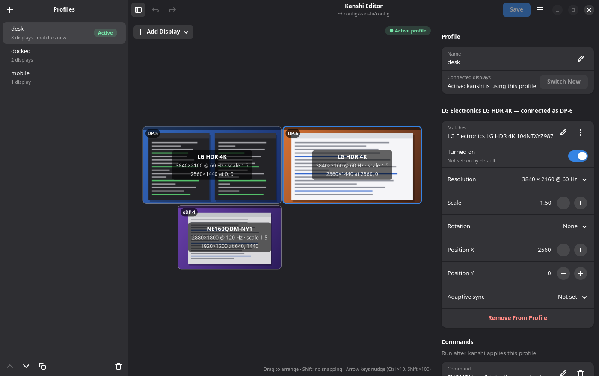

<p align="center">
  
</p>

<h1 align="center">Kanshi Editor</h1>

<p align="center">
  A visual editor for <a href="https://gitlab.freedesktop.org/emersion/kanshi">kanshi</a> display profiles,
  for sway and other wlroots compositors.
</p>

<p align="center">
  <a href="https://github.com/rene-langer/kanshi-editor/actions/workflows/ci.yml"></a>
  <a href="https://github.com/rene-langer/kanshi-editor/releases/latest"></a>
  <a href="LICENSE"></a>
</p>



Drag displays into place, set resolution, scale and rotation, and manage all your profiles,
including ones for monitors that aren't plugged in right now. **Your config file stays
yours:** comments, blank lines, indentation and alignment are kept. Only the lines you
change are rewritten, and *Show Changes* displays the exact diff before you save.

## Features

- **All profiles in one place**, in the order kanshi tries them. Reorder, duplicate,
  rename, delete, or start a new profile from the displays connected right now.
- **See which profile is active.** The profile kanshi is using is marked *Active*. When
  kanshi isn't running, the profile it would pick is marked *Expected*.
- **Tell identical monitors apart.** Each connected screen shows a live miniature of
  what's on it and its connector name (`DP-5`, `DP-6`), so two monitors of the same model
  can't be mixed up.
- **Drawn to scale**, after scale and rotation. Dragging snaps to the other displays'
  edges (hold <kbd>Shift</kbd> to place freely). Arrow keys nudge the selected display;
  <kbd>Ctrl</kbd> or <kbd>Shift</kbd> move it 10 or 100 pixels at a time.
- **Every option kanshi has:** what a display matches, on/off, resolution (from the
  monitor's real mode list), scale, rotation, position, adaptive sync, and the commands a
  profile runs.
- **Remembers monitors.** Profiles for another desk still know those monitors' sizes and
  modes.
- **Catches mistakes:** overlapping displays, displays the cursor can't reach, displays
  listed twice, unknown sizes.
- **Safe saving.** It writes through symlinks (fine for a dotfiles repo), won't silently
  overwrite a file another program changed, then reloads kanshi. *Switch Now* applies a
  profile immediately. Unlimited undo.
- Understands all of kanshi 1.9's syntax: block-form `output … { }`, global defaults,
  `alias $name`, `...output` and `include`. Lines it doesn't recognise are left as they are.

## Install

Download from the [latest release](https://github.com/rene-langer/kanshi-editor/releases/latest):

| Format | Install |
|---|---|
| **AppImage** (any distro) | `chmod +x kanshi-editor-*-x86_64.AppImage && ./kanshi-editor-*-x86_64.AppImage` |
| **Flatpak** | `flatpak install --user kanshi-editor-*.flatpak` (needs Flathub's GNOME runtime) |
| **Debian 13+, Ubuntu 24.04+** | `sudo apt install ./kanshi-editor_*_all.deb` |
| **Fedora** | `sudo dnf install ./kanshi-editor-*.noarch.rpm` |
| **Arch Linux** | `sudo pacman -U kanshi-editor-*-any.pkg.tar.zst` |

Each release also lists `SHA256SUMS`. Check a download with `sha256sum -c SHA256SUMS --ignore-missing`.

### From source

Needs Python 3.10+, GTK 4, libadwaita 1.5+, PyGObject and pycairo. Nothing comes from pip.

```sh
# Fedora: sudo dnf install python3-gobject gtk4 libadwaita make
# Debian/Ubuntu: sudo apt install python3-gi python3-gi-cairo gir1.2-gtk-4.0 gir1.2-adw-1 make
# Arch: sudo pacman -S python-gobject python-cairo gtk4 libadwaita make
git clone https://github.com/rene-langer/kanshi-editor && cd kanshi-editor
./bin/kanshi-editor                      # run from the checkout
make install-dev                         # or: link into ~/.local with a launcher entry
sudo make install PREFIX=/usr/local      # or: a system-wide install
```

### Works best with

- **kanshi** and `kanshictl`, for reloading, switching and showing the active profile.
- **swaymsg** (sway) or **wlr-randr** (other wlroots compositors), to list the connected
  displays.
- **grim**, for the screen miniatures. Turn them off with *Show Screen Contents* in the menu.

## Usage

`kanshi-editor` opens `~/.config/kanshi/config` (or `$XDG_CONFIG_HOME/kanshi/config`).
`kanshi-editor FILE` opens a different file.

- Pick a profile on the left, click a display to edit it, or drag it to move it.
  <kbd>Delete</kbd> removes the selected display from the profile.
- *Add Display* offers every monitor the editor has seen, plus `*` (any one display) and
  `...*` (any number of displays).
- <kbd>Ctrl</kbd>+<kbd>S</kbd> saves and runs `kanshictl reload`.
  <kbd>Ctrl</kbd>+<kbd>Z</kbd> and <kbd>Ctrl</kbd>+<kbd>Shift</kbd>+<kbd>Z</kbd> undo and redo.

kanshi uses the **first** profile whose displays all match what's connected, so put
specific profiles above general ones. *Matches, but kanshi picks … first* tells you when
an earlier profile wins.

### Privacy

Screen miniatures are taken with `grim` every few seconds, but only while the editor
window is focused. They stay in memory and are never written to disk. The editor only
reads and writes your kanshi config, plus a list of seen monitors and a settings file in
`~/.local/state/kanshi-editor/`.

### Flatpak permissions

The Flatpak needs `--filesystem=home`, because the config is often a symlink into a
dotfiles repository. It also needs `--talk-name=org.freedesktop.Flatpak`, to run
`swaymsg`, `wlr-randr`, `kanshictl` and `grim` on the host. Together these give the app
about the same access as a normally installed program.

## Contributing

Bug reports and pull requests are welcome. See [CONTRIBUTING.md](CONTRIBUTING.md) for the
development setup, tests, the demo mode (no monitors needed) and how releases are made.
Changes are listed in [CHANGELOG.md](CHANGELOG.md).

## License

[MIT](LICENSE) © Rene Langer and contributors. Kanshi Editor is not affiliated with the
kanshi project.
